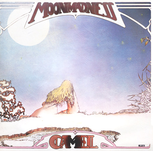

{fig-align="center"}

*Moonmadness* es el último disco de la primera formación de Camel: Latimer, Bardens, Ward y Ferguson. Camel venía de un disco conceptual totalmente instrumental, basado en la novela *The Snow Goose*. Creo que sentó bien al grupo el regreso a un formato de canciones de entre cinco y diez minutos, sin tener que seguir un único hilo conductor. Como es habitual en Camel, es música totalmente melódica, que se instala tranquilamente en el hemisferio derecho de tu cerebro. La música de Camel se puede usar como la música electrónica: a veces para acompañarte en el trabajo, a veces para escuchar con atención.

De este disco salieron dos temas clásicos del grupo: *Song within a Song* y *Lunar Sea*. Son dos temas que introducen cosas nuevas en Camel: el uso de contrapunto y un estilo jazzístico, que dicen que causó la marcha del grupo del bajista Doug Ferguson. La versión de Lunar Sea del fastuoso *A Live Record* se beneficia grandemente del saxo de Mel Collins. De manera similar al *White Rider* del Mirage, en *Song within a Song* hay muchas más ideas que en muchas suites de veinte minutos del rock progresivo. También destaca *Spirit on the Water*. En la edición extendida podemos escuchar la demo instrumental con piano: luego le añadieron letra y la flauta de Andy Latimer, otra seña de identidad de Camel.

