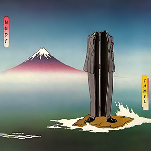

{fig-align="center"}

De los grupos de rock progresivo, Camel es el que más discos conceptuales ha publicado. Nude es el segundo de sus discos conceptuales, y cierra la tercera etapa de la banda, con Latimer y Ward como miembros originales. El disco se estructura en torno a la historia de Hiroo Onoda, uno de esos soldados japoneses que siguieron luchando años después de que acabara la Segunda Guerra Mundial, perdidos en las junglas de Asia. Viendo la historia de Nude y lo que se cuenta que ocurrió con Onoda, está claro que Camel se inspiró libremente en la historia, buscando ponerse en el lugar de alguien que tuviera esa experiencia.

Musicalmente, el disco es un testimonio de lo que podía dar de sí el rock progresivo en una época tan adversa como el principio de los ochenta. Los diversos temas del disco reflejan muy bien la trayectoria del protagonista: su vida en la ciudad, su reclutamiento, el aislamiento en la selva, la vuelta a casa, etcétera. Los temas más destacables son *Drafted*, *Captured* y *Lies*, sobre todo por su memorable interpretación en el disco en directo *Pressure Points*. Pero también es destacable *City Life*, un tema que puedes reproducir en tus auriculares cuando sales a pasear por la gran ciudad.

Una cuestión específica de este disco es su peculiar mezcla, que hace que se escuche a los músicos como si estuvieran tocando a cincuenta metros de distancia. En 2023 sacaron el disco en Spotify, con una edición remasterizada y una mezcla llamada *NEW Remixed 2023*. Vale mucho la pena escuchar esta nueva versión de Nude en pleno siglo XXI.

