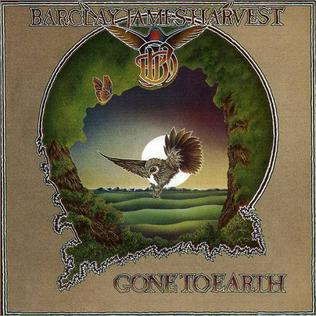

{fig-align="center"}

*Gone to Earth* es el cuarto de los cinco discos de la época central de Barclay James Harvest (BJH), presentando una banda en excelente estado de forma. Las dos canciones más conocidas del disco son *Hymn* y *Poor Man’s Moody Blues*. *Hymn* ha cerrado muchos de los conciertos del grupo, y es la canción más conocida de John Lees. Puede interpretarse con voz y guitarra acústica, y tiene la forma de una canción de iglesia. Se le han dado otras interpretaciones a esta canción, pero es inequívoco que es una profesión de fe cristiana. *Poor Man’s Moody Blues* es a la vez una sátira y una canción excelente. Mucha gente ha considerado a BJH como una réplica de los Moody Blues, sobre todo en su época con Harvest en la que recurrían con frecuencia a arreglos orquestales. Así que un día John Lees reescribió *Nights in White Satin* con una letra diferente. A mi juicio, la copia o parodia es superior al original, ni que sea porque la capacidad musical de BJH es superior a la de los Moody Blues.

Lo que hace grande a un grupo no son solo los hits de cada disco, sino los temas que han quedado más olvidados. Todos y cada uno de los temas de *Gone to Earth* son testimonio de la creatividad y capacidad musical de cada uno de los integrantes del grupo. No es habitual que tres de los cuatro miembros compongan temas y tengan capacidad de cantar e integrar armonías vocales. Especialmente quiero destacar que este disco es el tercero en tener temas de Wooly Wolstenholme, *Sea of Tranquility*. Y aunque *Taking me Higher* sea de Les Holroyd, es también un tema en el que el arte de Woolly destaca especialmente.

Como curiosidad para los que no pudieron ver la edición en vinilo, la portada del disco original estaba recortada, dejando ver la imagen del búho impresa en la funda interior del disco. Ediciones de derribo posteriores suprimieron esto, que quedó desterrado en las ediciones en CD.

[Más información.](https://www.bjharvest.co.uk/gone.htm)

