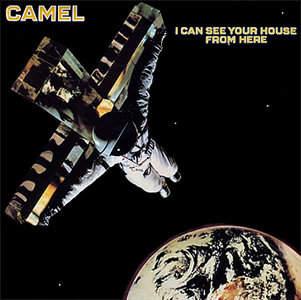

{fig-align="center"}

Este es el primer disco que Camel hace desde la salida de Peter Bardens. A partir de 1979, el principal compositor del grupo es Andy Latimer, que también es el propietario de la marca. La salida de Bardens es reemplazada por dos teclistas, Jan Schelhass y Kit Watkins. Otro reemplazo significativo es al bajo, en el que Richard Sinclair cede su puesto a Colin Bass. En este disco, Latimer se rodea en este disco de una larga lista de colaboradores, entre los que destacan Mel Collins y Vivienne McAuliffe. Vivienne es la cantante de *God if I Saw Her Now*, en *The Geese and the Ghost* de Anthony Phillips. Curiosamente, el productor de *I Can See your House from Here* es Rupert Hine, que también produjo los dos discos de Phillips en formato de rock progresivo: *Sides* y *Wise after the Event*.

Aunque Schelhaas ha sido miembro de Caravan muchos años, este disco no tiene arreglos de estilo Canterbury como los dos anteriores. Es una mezcla de temas claramente progresivos, o diría que sinfónicos, como *Wait*, *Eye of the Storm* o *Ice*, con otros temas más pop, como *Your Love is Stranger than Mine*, *Hymn to Her*, *Neon Magic* o *Remote Romance*. En *Who we Are* hay arreglos orquestales, y *Survival* es tema totalmente orquestal que abre la segunda cara. Con los temas pop Camel esperaba aumentar ventas y entrar en listas de éxitos, pero no salió demasiado bien. De todas maneras, *Your Love is Stranger than Mine* sigue siendo mi tema favorito de este disco. Parece que *Ice* es el tema favorito de los fans: es un tema tranquilo con predominio de guitarra y piano, con un trabajo de guitarra excelente de Latimer. Pero echen un vistazo a *Wait*, con dos excelentes solos de guitarra al principio y al final y la sección media con solos de teclado en los que se alternan Watkins y Schelhass, todo en cinco minutos.
