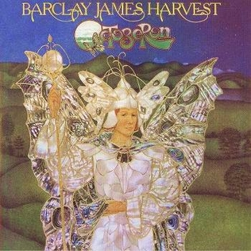

{fig-align="center"}

Este disco es el central de la edad de oro de la banda, la que va desde *Everyone Is Everybody Else* hasta *XII*. Como suele suceder con Barclay James Harvest (BJH), fue valorado negativamente por la crítica y es considerado un clásico entre sus fans, entre los que me honro en pertenecer. Este disco y el anterior, *Time Honoured Ghosts*, fueron dos intentos de acceder al mercado de Estados Unidos. No salió bien, así que no tuvieron la proyección comercial de otras bandas de rock progresivo. BJH ha estado siempre proyectado a Europa, más a Alemania o Suiza que al Reino Unido.

Yendo a la música, la primera cara del disco tiene tres temas, uno para cada uno de los miembros del grupo. The *World Goes On* es una maravilla de Les Holroyd, con una entrada de guitarra acústica muy efectiva y unos arreglos casi orquestales de teclado de Woolly al final. *May Day* es un gran tema de John Lees, poco interpretado en directo por la dificultad de integrar los coros al final de la canción. Se ha querido ver que la letra es ambigua, pero es claramente una alusión a la política en países del socialismo real, en el estilo de 1984. Eso tampoco ha ayudado a la popularidad de este tema. El tercer tema, *Ra*, es el Wooly Woolstenholme más sinfónico. Rock inspirado en don Gustav Mahler, con una muy buena guitarra de John Lees.

La segunda cara tiene cuatro temas, que al ser más cortos pueden ser más accesibles para el público en general. *Rock ‘n’ Roll Star* es una buenísima canción de Les Holroyd, con unos grandes arreglos en los que todos están a gran altura. *Polk Street Rag* tiene un estupendo solo de guitarra de John Lees, e inaugura una serie de temas más rockeros que la media de John Lees. *Believe in Me* muestra las habilidades del grupo en las armonías vocales, en una estupenda canción de amor de Les. Y el disco acaba con *Suicide?*, grandísima canción de John Lees en la que al final no sabemos si el protagonista se tiró o le empujaron...

[Más información.](https://www.bjharvest.co.uk/october.htm)

