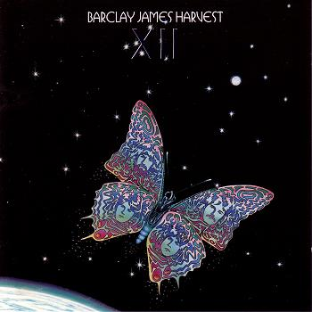

{fig-align="center"}

Este es el disco de estudio número doce (el duodécimo) de Barclay James Harvest (BJH), y el último que grabaron con Woolly Wolstenholme. Es el último de los cinco discos que forman la época central de BJH, que empieza con Everyone is Everybody Else. En este disco, BJH aparece como tres bandas diferentes con los mismos componentes, en el que cada uno fertiliza las canciones de los otros. BJH es de los pocos grupos en el que tres de sus cuatro miembros pueden componer y cantar sus propias canciones.

Las canciones de John Lees están tituladas como las secciones de una tienda de libros, las secciones se suprimieron en lanzamientos posteriores del disco. La mejor es *Nova Lepidoptera*, inspirada en libros de ciencia ficción de la época y con una gloriosa sección final con dos solos de guitarra entrelazados. *A Tale of Two Sixties* sigue la tradición de letras a partir de títulos de canciones como Titles en el Time Honoured Ghosts. Y *Loving Is Easy* retoma la vena erótico-festiva de *Polk Street Rag*. Versos como *just get a hold and watch how it grows* hicieron que se censurara la canción (sí, en el Reino Unido de 1978 se censuraban letras de canciones).

Les Holroyd hace canciones menos sofisticadas que las de John Lees, sin que tengan menos mérito por ello. La que tuvo más repercusión fue *Berlin*, dedicada a la ciudad entonces repartida entre las dos Alemanias, en la que la parte occidentan estaba rodeada por la República Democrática Alemana. BJH siempre tuvo mucho seguimiento en Alemania, y este tema es muy importante en la historia del grupo, además de ser excelente. *Turning in Circles* es una predecesora de *Living Is Easy*, y *Sip of Wine* destaca por las dos guitarras que se entrelazan durante todo el tema, una forma de componer que no habían retomado desde la época Harvest.

En este disco, Woolly tiene dos canciones. Las dos tienen el toque especial de Woolly, especialmente apreciado por prodigarse poco. Significativamente, en *In Search of England* y *Harbour* hay muy buenas partes de guitarra de John Lees, quizá prefigurando su colaboración muchos años después. Woolly representa una sensibilidad típicamente inglesa, difícil de trasplantar incluso a países afines como los Estados Unidos. Esta cultura fuertemente inglesa establece una conexión con Anthony Phillips, el primer guitarrista de Genesis.

*Giving It Up* y *The Streets of San Francisco*, la primera de Les Holroyd y la segunda de John Lees, cierran el disco y la etapa central de BJH. Son dos canciones atmosféricas, enlazadas una con otra y con un excelente trabajo de teclado de Wooly Wolstenholme. Para mi es una de las cimas del grupo, y representan lo que era BJH entonces: cuatro personas con un gran talento musical contribuyendo generosamente al acervo del grupo.

[Más información.](https://www.bjharvest.co.uk/xii.htm)

