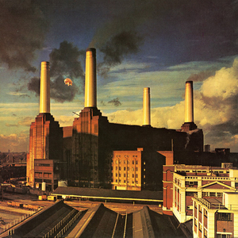

{fig-align="center"}

 *Animals* está inspirado libremente en Animal Farm de George Orwell. Las tres canciones del disco son los tres grupos sociales de la obra de Orwell: los perros *Dogs*, los cerdos *Pigs (Three Different Ones)* y las ovejas *Sheep*. El disco empieza y acaba con las dos partes *Pigs on the Wing*, una bella canción de voz y acústica no relacionada con el tema del disco. 
 
*Animals* es el primer disco en que empieza a verse la progresiva toma del poder de Roger Waters en Pink Floyd. En una operación frecuente en los intérpretes de Orwell, Waters transforma el foco de *Animal Farm*. En la obra de Orwell, los cerdos son los altos cuadros del Partido, los perros la policía política y las ovejas el proletariado. Waters opta por una crítica al capitalismo: las ovejas siguen siendo el proletariado, los cerdos son diversos representantes de la clase política (el segundo cerdo es Margaret Thatcher) y los perros son los directivos de las grandes corporaciones financieras y de servicios profesionales. Al final de la historia, las ovejas matan a los perros y toman el poder.

Musicalmente, el disco busca un equilibrio entre Waters y David Gilmour, en detrimento de Rick Wright, que cada vez colaborará menos en las composiciones. En los tres temas largos centrales, Gilmour hace un trabajo extraordinario, muy alejado del sonido de *Dark Side of the Moon* o de los *Shine On You Crazy Diamond*. *Pigs (Three Different Ones)* recuerda a *Welcome to the Machine*, pero el resto de temas es un nuevo sonido para Pink Floyd, en el que en cierto modo se acercan al sonido *punk* dentro de lo que puede ser Pink Floyd, y responden a la petición de la crítica de dejar de ser escapistas y acercarse al mundo real. Pero no hay que hacer demasiado caso a la crítica: algunos de nosotros aún recordamos a Margaret Thatcher, pero nadie recuerda a Mary Whitehouse, el tercero de los cerdos. Bueno, ha permanecido en la memoria de aquellos que aún escuchamos a Pink Floyd.
