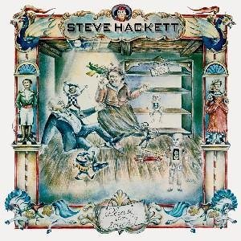

{fig-align="center"}

*Please Don’t Touch!* es el segundo disco de Steve Hackett, y el primero que grabó después de dejar Genesis en Octubre de 1977. Sus ideas musicales no tenían la recepción que él quería por parte de Banks, Collins y Rutherford, y las razones para ello se empezaron a ver a partir de *Duke*. En las décadas siguientes, sobre todo a partir del lanzamiento de los dos *Genesis Revisited*, Hackett mantuvo el recuerdo de la primera etapa de Genesis.

A diferencia de *Voyage of the Acolyte*, Hackett no cuenta con ninguno de sus ex-compañeros de banda. Algunos de los nuevos colaboradores serán la banda de soporte a Steve Hackett en directo. Otros son músicos que le aseguran un sonido diferente al de Genesis: Steve Walsh y Phil Earth de Kansas, Graham Smith de Van der Graaf Generator y los cantantes Richie Havens y Randy Crawford.

En la cara A, *Narnia* y *Racing in A* son los temas con Steve Walsh, y por tanto un *crossover* de Kansas con Genesis. *Kim* es un tema con acústica y flauta, que aparecería más tarde en el *Bay of Kings*. *Carry on up the Vicarage* es una broma victoriana, del ambiente de *Nursery Cryme*, y *How Can I?* es un tema muy original (verdadero rock progresivo) con la estupenda voz de Richie Havens. La cara B está concebida como una suite de cinco temas, que empieza con dos temas cantados, *Hoping Love Will Last* por Randy Crawford e *Icarus Ascending* por Richie Havens. En medio, tres temas instrumentales: *Land of a Thousand Autumns*, *Please Don’t Touch* y *The Voice of Necam*. Según las instrucciones del disco, *Please Don’t Touch* debe reproducirse con todo el volumen que dé de si el reproductor musical disponible.

Con *Please Don’t Touch!* Steve Hackett inicia la que sería una larga carrera en solitario. Es un disco muy original, a la que seguramente dio salida a mucho material que no pudo vehicular en Genesis, y en el que pudo expresar con más libertad sus ideas.
