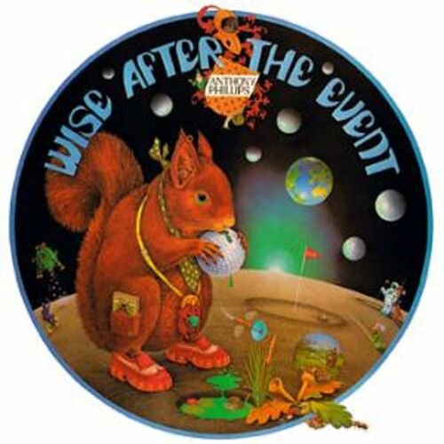

{fig-align="center"}

Como es sabido, Anthony Phillips dejó Genesis después de *Trespass* y no volvió a sacar material hasta 1977 con *The Geese and the Ghost*. Durante ese tiempo, Genesis había sacado toda su producción con Peter Gabriel y Steve Hackett. *The Geese and the Ghost* era un álbum irrepetible, que estuvo componiendo y grabando durante mucho tiempo, así que Phillips tenía que dar otro enfoque a su carrera. Es el que dio con *Wise After the Event*, con la colaboración de dos excelentes músicos: el batería Michael Giles y el bajista John G. Perry.

A diferencia de su disco anterior, en este todas las canciones son cantadas por el propio Anthony Phillips. Se supone que tenían que ser canciones pop comerciales, y así se explica en muchos reportes sobre el disco. Pero no es del todo cierto: las letras son bastante peculiares. Así empieza el disco, por ejemplo:

::: {style="margin-bottom: 1rem;"}
| August saw a contest fit for Kings
| From far and wide they came to trade their swings
| Little grubs with stone-age clubs and tanners' sons
| With foxes' gloves
| They came face to face the stiffest coarse since Tring.

:::

Ya me dirán ustedes si esto es una canción pop. El tema *Wise after the Event* dura diez minutos, y el que cierra el disco, *Now What (Are They Doing to My Little Friends)* dura ocho minutos. Los arreglos musicales son complejos, con overdubs de guitarra acústica y eléctrica. Y Regrets es una canción con piano y orquesta con arreglos musicales bastante trabajados. 

Desde mi punto de vista, *Wise After the Event* es un disco de auténtico progresivo, al crear un estilo propio, e incluso un universo propio. La música, las letras de las canciones y las portadas de Peter Cross crean un universo propio, que luego se extendió a *Sides* y a través de las peculiares *Private Parts and Pieces*, un formato que permitía publicar todo aquello que fuera creando. Seguramente la popularidad de Phillips quedó lastrada por su miedo escénico, que le impidió presentar su música en directo.

